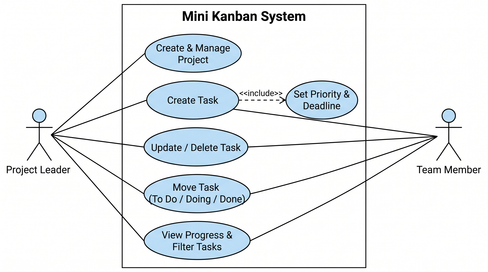

# 📋 Mini Kanban — Task & Progress Tracking System
**نظام مصغر لإدارة المهام وتتبع الإنجاز**

* **Course Deliverable:** Software Engineering Project — Phase 1 (System Analysis, Use Case Modeling & Mini-SRS)
* **Prepared By:** Mashhour Rami Mashhour Abu Snaineh (`مشهور رامي مشهور أبو سنينة`)
* **University ID:** `2350908014`
* **Role:** Phase 1 Lead — System Analysis & Use Case Modeling
* **Process Model:** Iterative & Incremental (Agile Mini-Scrum — 4 Weeks / 5 Moodle Phases)

---

## 1. System Analysis & Process Model Justification (CLO1 & CLO3)

### 1.1 Problem Statement & System Overview
Small academic and software development teams frequently coordinate daily tasks through scattered chat threads or static lists, leading to unclear task ownership, unprioritized workloads, missed deadlines, and zero real-time visibility into project completion.

**Mini Kanban** is a lightweight web-based Task & Progress Tracking System organized around a visual three-column workflow board (**To Do**, **Doing**, **Done**). It enables a **Project Leader** to create isolated project workspaces and assign tasks with explicit priority levels (`Low`, `Medium`, `High`) and deadline dates, while empowering **Team Members** to transition tasks across workflow columns. Every status transition is automatically logged into a relational audit table (`task_history`) to calculate accurate, real-time completion percentages.

### 1.2 Core MVP Scope (5 Essential Features)
1. **Create & Manage Projects:** Establish isolated project workspaces owned by a Project Leader.
2. **Full Task CRUD Operations:** Complete Create, Read, Update, and Delete lifecycle management for tasks.
3. **3-Column Kanban Workflow Distribution:** Organize and transition tasks across `To Do`, `Doing`, and `Done` columns with automatic history logging.
4. **Task Priority & Deadline Scheduling:** Enforce urgency levels (`Low`, `Medium`, `High`) and ISO deadline dates (`YYYY-MM-DD`) on every task.
5. **4-Table Relational Persistence:** Store all data in a normalized relational database (`users`, `projects`, `tasks`, `task_history`).

### 1.3 Software Process Model Justification: Iterative & Incremental (Agile Mini-Scrum)
The team selected the **Iterative & Incremental (Agile Mini-Scrum)** process model over the traditional Waterfall model to satisfy **CLO1** and **CLO3**:

| Evaluation Criterion | Waterfall Model (Rejected) | Iterative & Incremental Mini-Scrum (Selected) |
| :--- | :--- | :--- |
| **Instructor Feedback Loop** | Feedback occurs after coding is finished, making requirement fixes costly. | Weekly Moodle feedback gates (Phases 1–3) allow early refinement of SRS, ER, and UI. |
| **Risk & Integration Timing** | Late integration in Week 4 risks schema and UI mismatches. | Incremental weekly handoffs verify schema, backend CRUD, and UI early. |
| **5-Member Parallelism** | Downstream developers wait idle until documentation is completely frozen. | Analysis, ER design, UI mockups, and CRUD coding progress concurrently across weekly sprints. |

---

## 2. Use Case Modeling & Specifications

### 2.1 UML Use Case Diagram

### 2.2 Actors & Dependency Rules
* **Project Leader (Primary Actor):** Creates and manages projects, creates/assigns tasks, updates/deletes tasks, moves tasks across columns, and monitors completion metrics.
* **Team Member (Primary Actor):** Collaborates within assigned projects by creating tasks, updating details, moving tasks (`To Do` → `Doing` → `Done`), and filtering/viewing progress.
* **`<<include>>` Relationship (`UC-02 Create Task` ➔ `UC-03 Set Priority & Deadline`):** Creating a task obligatorily includes setting a valid Priority (`Low`, `Medium`, `High`) and a Deadline date; the system rejects saving tasks without them.

### 2.3 Use Case Specification Summary

| ID | Use Case Name | Primary Actor(s) | Precondition | Postcondition / System Outcome |
| :--- | :--- | :--- | :--- | :--- |
| **UC-01** | **Create & Manage Project** | Project Leader | Leader account exists in `users`. | New project saved in `projects` with `owner_id`. |
| **UC-02** | **Create Task** | Project Leader, Team Member | Active project and valid assignee exist. | New task saved in `tasks` with initial status `TODO`. |
| **UC-03** | **Set Priority & Deadline** | *Included by UC-02 (`<<include>>`)* | Task creation form is open. | Stores validated priority (`LOW`/`MEDIUM`/`HIGH`) and ISO deadline. |
| **UC-04** | **Update / Delete Task** | Project Leader, Team Member | Target task exists in database. | Task updated in `tasks`, or deleted along with its history via cascade. |
| **UC-05** | **Move Task (`To Do` / `Doing` / `Done`)** | Project Leader, Team Member | Task exists in a valid state. | `tasks.status` updated and transition logged in `task_history`. |
| **UC-06** | **View Progress & Filter Tasks** | Project Leader, Team Member | Project exists in database. | Displays live completion % (`Done / Total`) and filtered task cards. |

---

## 3. Simplified Software Requirements Specification (Mini-SRS)

### 3.1 Functional Requirements (FR)

| Req ID | Requirement Title | Technical Specification | Mapped UC / Table |
| :--- | :--- | :--- | :--- |
| **FR-1** | **Project Creation & Management** | The system shall allow a Project Leader to create new projects (`name`, `description`, `owner_id`) and list all active projects. | `UC-01` (`users`, `projects`) |
| **FR-2** | **Full Task CRUD Operations** | The system shall support Create, Read (single & project-wide list), Update, and Delete operations on tasks. | `UC-02`, `UC-04` (`tasks`) |
| **FR-3** | **Kanban Workflow & History Logging** | The system shall distribute tasks across `TODO`, `DOING`, and `DONE` columns. Moving a task shall update `tasks.status` and auto-insert (`old_status`, `new_status`, `changed_at`) into `task_history`. | `UC-05` (`tasks`, `task_history`) |
| **FR-4** | **Priority & Deadline Validation** | The system shall enforce mandatory selection of a valid priority (`LOW`, `MEDIUM`, `HIGH`) and ISO deadline date (`YYYY-MM-DD`), rejecting empty titles or invalid values. | `UC-03` (`tasks`) |
| **FR-5** | **Progress Calculation & Filtering** | The system shall dynamically calculate project completion percentage as `(DONE_tasks / Total_tasks) * 100` and filter tasks by status, priority, or assignee. | `UC-06` (`projects`, `tasks`) |

### 3.2 Non-Functional Requirements (NFR)

| Req ID | Quality Attribute | Requirement Specification |
| :--- | :--- | :--- |
| **NFR-1** | **3-Tier Architectural Separation** | Strictly separate Presentation (Frontend UI), Application Logic (Python CRUD & validation), and Data Storage (SQLite/PostgreSQL). Direct SQL queries from the UI are prohibited. |
| **NFR-2** | **Usability & Visual Clarity** | Render all three columns (`To Do`, `Doing`, `Done`) side-by-side with color-coded priority badges (`Red` = High, `Yellow` = Medium, `Blue` = Low). |
| **NFR-3** | **Data & Referential Integrity** | Enforce Primary Keys, `UNIQUE` email constraints, Foreign Keys with `ON DELETE CASCADE`, and parameterized SQL queries to prevent SQL injection. |
| **NFR-4** | **Version Control & Traceability** | Maintain all deliverables and source code in this shared GitHub repository with individual member commits mapped to weekly Moodle phases. |

---

## 4. Relational Database CRUD Operations Matrix (4 Tables)

| Entity (Table) | **C** — Create | **R** — Read | **U** — Update | **D** — Delete |
| :--- | :--- | :--- | :--- | :--- |
| **`users`** *(id, full_name, email, role, created_at)* | Register a new team member (`create_user`) with unique email validation. | Fetch user profile or populate the Assignee dropdown list in the UI. | Update user display name or role. | Remove user record (restricted if owning active projects). |
| **`projects`** *(id, name, description, owner_id, created_at)* | Create a new project (`create_project`) linked to `owner_id`. | List all projects (`list_projects`) or retrieve project metadata & progress %. | Edit project title or description. | Delete project; triggers `ON DELETE CASCADE` to remove all child tasks. |
| **`tasks`** *(id, project_id, assignee_id, title, description, status, priority, deadline, created_at)* | Insert a new task (`create_task`) with default status `TODO`, priority, and deadline. | View single task (`get_task`) or list/filter tasks by column (`list_project_tasks`). | Edit task fields (`update_task_details`) or transition status (`update_task_status`). | Delete specific task (`delete_task`); cascades deletion to `task_history`. |
| **`task_history`** *(id, task_id, old_status, new_status, changed_at)* | **Auto-inserted** whenever `update_task_status` moves a task between columns. | Query chronological status transitions per task for workflow auditing. | *Immutable Audit Log* (records are never manually edited). | Automatically deleted via `ON DELETE CASCADE` when parent task is deleted. |

---

## 5. Team Handoff Contract (Phases 2 & 3)
* **Fares Al-Natsheh (Phase 2 — ER & Architecture):** Implement the 4-table SQL schema (`users`, `projects`, `tasks`, `task_history`) with PK/FK constraints and `ON DELETE CASCADE` rules matching Section 4.
* **Qusai Abu Khalil (Phase 2 — UI Mockups & Phase 3 — Frontend):** Design the 3 wireframe screens (Project Header & Progress Bar, 3-Column Kanban Board, Task Create/Edit Modal) covering `UC-01` through `UC-06`.
* **Laith Jaber (Phase 3 — Backend CRUD):** Implement parameterized Python CRUD functions (`create_user`, `create_project`, `create_task`, `get_task`, `list_project_tasks`, `update_task_details`, `update_task_status`, `delete_task`, `get_project_progress`) satisfying `FR-1` to `FR-5`.
* **Ziad Al-Baraisi (Phase 3 — QA & Testing):** Derive positive and negative `pytest` cases directly from `FR-1` through `FR-5`.
